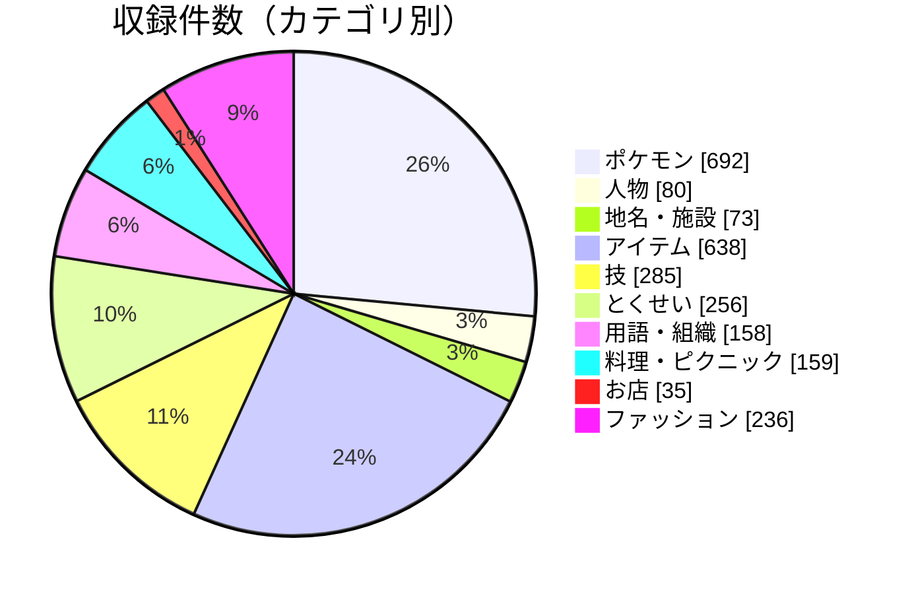

# 収録状況

> `node tools/coverage.js` でデータから自動生成しています（最終生成：2026-11-23）。
> 件数だけを載せていて、ネタバレになる名前は書いていません。
> このアプリは作者の推測をまとめたベストエフォートの図鑑で、ゲームのすべての言葉を網羅することを保証するものではありません。

収録件数：**2612 件**（ポケモンは追加コンテンツ「ゼロの秘宝」の図鑑も含む。ほかの作品・ポケモンHOME・配信がないと手に入らない道具や姿は原則対象外。ただし、SVの図鑑に載るポケモンは、配信が必要なものも収録）

## カテゴリごとの件数

| カテゴリ | 件数 | |
| --- | ---: | --- |
| ポケモン | 692 | `████████████████████████` |
| 人物 | 80 | `███` |
| 地名・施設 | 73 | `███` |
| アイテム | 638 | `██████████████████████` |
| 技 | 285 | `██████████` |
| とくせい | 256 | `█████████` |
| 用語・組織 | 158 | `█████` |
| 料理・ピクニック | 159 | `██████` |
| お店 | 35 | `█` |
| ファッション | 236 | `████████` |

## 小分類ごとの件数

**人物**：主人公・ライバル 5／博士 2／ジムリーダー 8／ポケモンリーグ 4／スター団 7／アカデミーの先生 8／そのほかの人物 2／トレーナーの種類 29／ゼロの秘宝の人物 15

**地名・施設**：パルデア地方 44／キタカミの里（碧の仮面） 20／ブルーベリー学園（藍の円盤） 9

**アイテム**：ボール 23／回復・飲み物 25／育成（ドーピング・アメ・ミント） 52／バトル用の使い捨て道具 10／持ち物（バトル用） 85／タイプの技を強くする持ち物 20／進化・姿を変える道具 56／テラスタル・テラピース 21／きのみ 53／お宝（売るための道具） 17／大切なもの 16／ピクニック用品 80／ポケモンの落とし物 180

**技**：第9世代で登場した技 69／わざマシンの技 216

**とくせい**：第9世代で登場したとくせい 31／第8世代までに登場したとくせい 225

**用語・組織**：ゲームのしくみ（システム） 36／せいかく（25種） 25／リボン・あかし・二つ名 56／物語・組織・場所の言葉 29／ゼロの秘宝の言葉 12

**料理・ピクニック**：サンドウィッチのレシピ 37／サンドウィッチの材料・調味料 57／お店のメニュー 63／ピクニック・食事 2

**ファッション**：ブランド 14／制服・上下 18／ヘッドウェア 46／アイウェア 26／グローブ 14／バッグ 13／レッグウェア 22／シューズ 17／スマホロトムのカバー 66

## 主な内訳

作者が決めた対象範囲ごとの件数です（範囲の決め方は下の「対象範囲の決め方」）。

| 分野 | 内訳 | 件数 |
| --- | --- | ---: |
| ポケモン | パルデア図鑑（本編 400 種） | 400 |
| ポケモン | スカーレット・バイオレット初登場（No.906〜1008） | 103 |
| ポケモン | キタカミ図鑑（碧の仮面） | 200 |
| ポケモン | ブルーベリー図鑑（藍の円盤） | 243 |
| ポケモン | 追加コンテンツの図鑑だけに載っているポケモン | 263 |
| ポケモン | 追加コンテンツで初登場したポケモン（No.1009〜1025） | 17 |
| ポケモン | パルデア図鑑にないが本編で手に入るポケモン（交換・もらう） | 2 |
| ポケモン | 図鑑に載らない伝説・幻のポケモン（藍の円盤のクリア後） | 27 |
| ポケモン | パラドックスポケモン（追加コンテンツを含む） | 22 |
| わざマシン | わざマシン（本編 No.001〜171） | 171 |
| わざマシン | わざマシン（追加コンテンツ No.172〜229） | 58 |
| 技 | わざマシンの技のうち、第1〜8世代からある技（本編） | 165 |
| 技 | 追加コンテンツのわざマシンの技と、追加コンテンツで登場した技 | 72 |
| 技 | 第9世代で登場した技（本編。スターモービルの技を含む） | 48 |
| アイテム | 第9世代で登場した持ち物（バトル用） | 7 |
| アイテム | 第9世代で登場した進化用の道具 | 4 |
| アイテム | 本編のバッグに入る道具すべて（わざマシンを除く） | 646 |
| アイテム | ポケモンの落とし物（わざマシンの材料） | 181 |
| とくせい | 収録しているポケモンが持つとくせいすべて（隠れ特性を含む） | 256 |
| とくせい | そのうち第9世代で登場したとくせい（追加コンテンツを含む） | 40 |
| 用語 | せいかく | 25 |
| 人物 | ジムリーダー | 8 |
| 人物 | ポケモンリーグ（四天王・トップ） | 5 |
| 人物 | スター団のボス（5 人＋カシオペア） | 6 |
| 人物 | アカデミーの先生（校長・保健室を含む） | 9 |
| 人物 | トレーナーの種類（本編のパルデアで勝負するもの） | 23 |
| 人物 | ゼロの秘宝の人物 | 15 |
| 人物 | ゼロの秘宝のトレーナーの種類 | 6 |
| 地名 | キタカミの里の地名（碧の仮面） | 20 |
| 地名 | ブルーベリー学園の地名（藍の円盤） | 9 |
| 用語 | ゼロの秘宝のあかし・リボン | 2 |
| お店 | ゼロの秘宝のお店 | 3 |
| 料理 | ゼロの秘宝の料理（食事パワーつき） | 5 |
| ファッション | ゼロの秘宝のファッション（色違いはまとめて1件） | 93 |
| 用語 | ゼロの秘宝の言葉 | 12 |
| アイテム | ゼロの秘宝のアイテム | 49 |
| 用語 | あかし（本編で付くもの） | 47 |
| 用語 | リボン（本編でもらえるもの） | 4 |
| 地名 | 町・都市 | 12 |
| 地名 | パルデア十景 | 10 |
| 地名 | 災厄のポケモンの祠 | 4 |
| お店 | お店・飲食店（本編のチェーン店と専門店） | 32 |
| お店 | 出店先の町が分かるお店（フレンドリィショップを除く） | 31 |
| 料理 | サンドウィッチのレシピ（系統） | 37 |
| 料理 | 飲食店のメニュー（本編。寿司のセットはまとめて数える） | 58 |
| 料理 | 食事パワーが分かるメニュー | 58 |
| 料理 | レシピと食事パワーが分かるサンドウィッチの系統 | 37 |
| 料理 | サンドウィッチの材料・調味料 | 58 |
| ファッション | ファッションブランド | 14 |
| ファッション | 服・小物・スマホロトムのカバー（本編で手に入るもの） | 129 |

## ネタバレ段階ごとの件数

| カテゴリ | 序盤 | 本編 | 終盤 | クリア後 |
| --- | ---: | ---: | ---: | ---: |
| ポケモン | 111 | 521 | 10 | 50 |
| 人物 | 33 | 40 | 3 | 4 |
| 地名・施設 | 12 | 52 | 8 | 1 |
| アイテム | 255 | 358 | 15 | 10 |
| 技 | 61 | 207 | 8 | 9 |
| とくせい | 118 | 111 | 11 | 16 |
| 用語・組織 | 118 | 32 | 4 | 4 |
| 料理・ピクニック | 53 | 105 | 1 | — |
| お店 | 9 | 26 | — | — |
| ファッション | 10 | 204 | — | 22 |
| **合計** | **780** | **1656** | **60** | **116** |

- **序盤**：ゲーム開始〜テーブルシティ・アカデミー入学のころまでに分かる情報
- **本編**：3つのストーリー（ジム・スター団・ヌシ）の道中で出会うポケモン・人物・技。追加コンテンツの道中で出会うポケモンもここ
- **終盤**：各ストーリーの終盤、チャンピオンテスト・ポケモンリーグ、伝説・災厄のポケモン。追加コンテンツの物語の山場で出会う伝説のポケモンもここ
- **クリア後**：エンディング以降の物語、エリアゼロ、パラドックスポケモン。追加コンテンツのエピローグ・クリア後に出会うポケモンもここ

## 推測について

| 確からしさ | 意味 | 件数 |
| --- | --- | ---: |
| ★★★ | 綴りや語の対応がはっきりしている | 2420 |
| ★★ | 意味や図鑑の説明と合う、よく言われる説 | 181 |
| ★ | 根拠が弱い、または由来がはっきりしない | 11 |

- 由来の説を複数並べている名前：**566 件**
- 「分からないこと」（裏取りできなかった点）を書いている名前：**12 件**
- 進化の系統を載せているポケモン：**584 種**／姿・フォルムを載せているポケモン：**60 種**

## 対象範囲の決め方

- **ポケモン**：本編のパルデア図鑑 400 種、追加コンテンツ「ゼロの秘宝」のキタカミ図鑑 200 種・ブルーベリー図鑑 243 種、図鑑にはないが本編の交換・プレゼントで手に入るポケモン（ヌオー・ニャイキング）。ヌオーはキタカミ図鑑にも載っている。
- **わざマシン**：本編のわざマシン No.001〜171 と、追加コンテンツの No.172〜229。技はわざマシンの技と、本編で登場した第9世代の技（スターモービル専用の技を含む）。
- **とくせい**：3つの図鑑のポケモンが持つとくせい（隠れ特性を含む）。
- **アイテム**：本編（Ver.1.0.0）でバッグに入る道具（わざマシンを除く）。Bulbapedia の第9世代の道具の一覧から、追加コンテンツで増えたものと、ほかの作品・ポケモンHOME・配信がないと手に入らない道具を除いています。
- **人物・地名・用語・アイテム**：本編と追加コンテンツ（キタカミの里・ブルーベリー学園）の主な人物・トレーナーの種類・地名・言葉・道具。
- **地名・お店・料理・ファッション**：本編で行ける場所・お店と、そこで出会う料理・服（追加コンテンツ、ほかの作品のセーブデータ連動、配信で手に入るものは除く）。寿司のセットはまとめて数えています。
- **用語**：ゲームのしくみ、せいかく、リボン・あかし・二つ名、物語・組織の言葉。

## これから増やしたいもの

- ほかのポケモンが覚える技（レベルアップ・タマゴ技）
- 名前のある NPC、ヌシの呼び名、エリア・洞窟などの細かい地名
